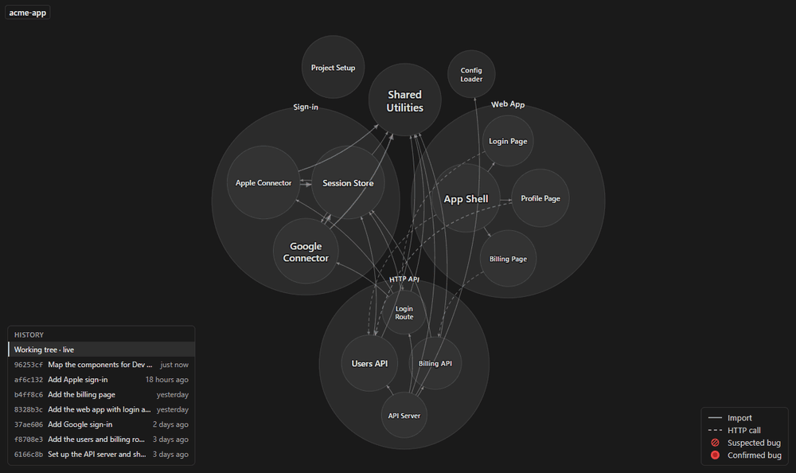
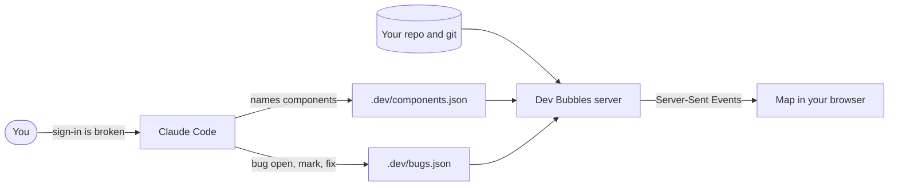
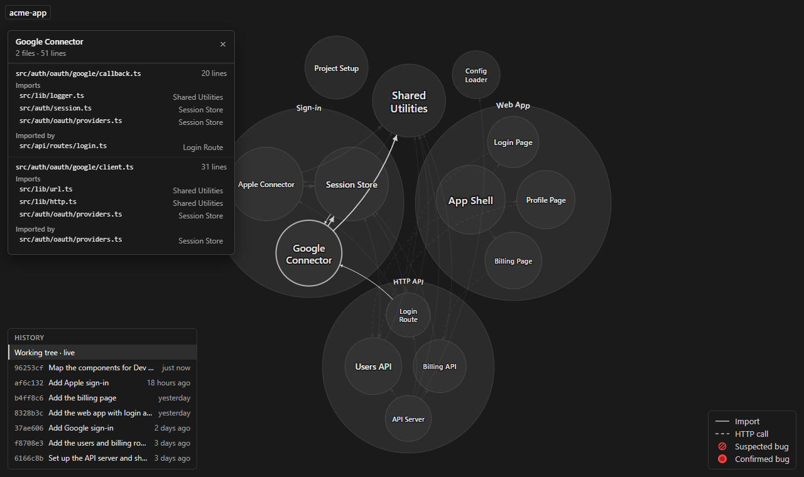
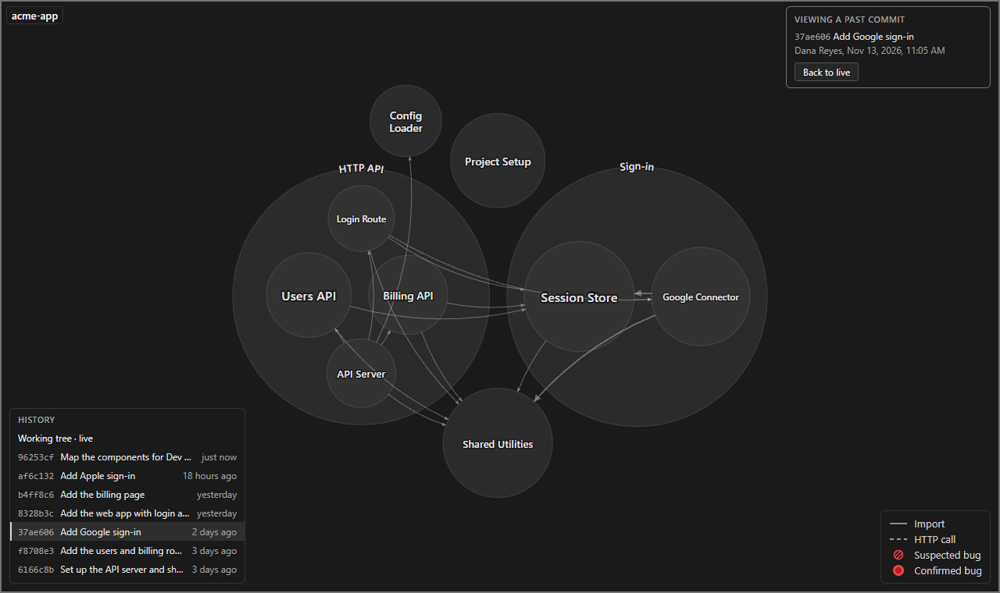

# Dev Bubbles

A live map of your codebase that your coding agent draws and keeps up to date. The agent groups the code into named components, the map shows how they import and call each other, and when you say "this part doesn't work" the agent marks the suspects in red while it investigates.



<sub>A demo app with a bug in its Google sign-in, played with the same `bug` commands the agent runs: three suspects are striped, the agent narrows them down, confirms the cause in solid red, and the marks clear once it is fixed.</sub>

## Install

You need Node.js 22.12 or newer, git and Claude Code. In the project you want to map, run:

```sh
npx skills add oynozan/dev-bubbles
```

Then tell Claude Code **"set up dev bubbles"**. In about a minute the agent clones Dev Bubbles into `.dev/dev-bubbles/`, installs it, starts the map in your browser at http://127.0.0.1:4747 and names your components. From then on:

- every Claude Code session starts the map server by itself
- a bug report in plain words ("the export button does nothing") turns into red marks on the map, with no `/bug` needed
- new files, edits and commits show up on the map within half a second
- the agent keeps the components current as it adds and moves code

<details>
<summary>Manual install</summary>

From the root of your project:

```sh
git clone https://github.com/oynozan/dev-bubbles.git .dev/dev-bubbles
npm install --prefix .dev/dev-bubbles
node .dev/dev-bubbles/dist/bin/cli.js init .
node .dev/dev-bubbles/dist/bin/cli.js up --open
```

Then run `/map` in Claude Code to name the components. To update later, run `git -C .dev/dev-bubbles pull` and the last three lines again, or ask the agent to set up Dev Bubbles again.

For a global `dev-bubbles` command, clone the repo anywhere, run `npm install` and `npm link` in it, then `dev-bubbles init .` and `dev-bubbles up --open` in your project.

</details>

## How it works



1. **The agent names the parts.** It reads a summary of the repo (directories, lines of code, imports between them) and writes `.dev/components.json`: components such as Google Connector or Billing API, each matched to files by globs. Dev Bubbles itself never calls an LLM and needs no API key.
2. **The server reads the code.** For JavaScript and TypeScript it resolves imports, including tsconfig paths, and matches `fetch` and `axios` calls to Express, Fastify, Hono and Next.js routes. For other languages, and for connections no parser can see such as API clients, IPC or events, the agent draws the lines itself in the `edges` list of `components.json` and keeps them current as the code grows.
3. **Bugs are a file too.** When you describe a problem, the agent runs `bug open`, `bug mark` and `bug fix`, which write `.dev/bugs.json`. Suspects are striped red, the confirmed cause is solid red, and fixing the bug clears its marks.
4. **Every change is pushed to the map.** The server watches your files, the git index and HEAD, and the `.dev/` files. On a change it rebuilds the map and pushes it to the browser, about 0.4 s after the save or commit. Nothing polls.
5. **Hooks keep the agent on track.** `init` adds three Claude Code hooks:

| Hook | What it does |
| --- | --- |
| SessionStart | Starts the map server if it is not running and reminds the agent of the rules |
| UserPromptSubmit | When your message reads like a problem report ("doesn't work", "broken", "error"), tells the agent to put the bug on the map before investigating |
| Stop | While the map is out of date, such as files that match no component or invalid JSON, keeps the agent from ending its turn until it fixes the map, at most once per turn |

## What you see

Bubbles are your components, sized by lines of code and labeled by the agent, never by file or folder names. Solid lines are imports and dashed lines are HTTP calls. Color is only used for bugs.

**Click a bubble** to see its files, what each one imports, what imports it and the HTTP calls it makes. The window can be dragged anywhere.



**Pick a commit** at the bottom left to see the repo as it was then. New commits appear in the list as you make them.



Zoom with the wheel, pan with the middle mouse button, drag a bubble to pin it and double-click to unpin it. A bug mark hidden inside a zoomed-out bubble shows as a red ring with a count.

## Try the bug flow

- **With your agent.** In the mapped project, describe a problem the way you would to a colleague: "saving the profile shows a blank page". Watch the suspects appear before the agent reads any code.
- **Scripted demo.** In a clone of this repo, run `npm run dev` and open http://localhost:5173, then run `npm run demo:bug` in a second terminal. It plays a made-up bug one step every few seconds. Pass a path to play it in another repo with a `components.json`: `npm run demo:bug -- /path/to/repo`.
- **By hand.** Run the commands yourself, with a component id from your `components.json` and one of your files:

```sh
dev-bubbles bug open "Trying out the marks"                  # prints the id, b1 here
dev-bubbles bug mark b1 auth suspected "just testing"
dev-bubbles bug mark b1 src/auth/session.ts confirmed "found it"
dev-bubbles bug fix b1
```

Here `dev-bubbles` stands for `node .dev/dev-bubbles/dist/bin/cli.js` run from the project root.

## Reference

### CLI

```
dev-bubbles <command> [repo] [options]
```

`[repo]` defaults to the current directory, and any folder inside a git repository maps the whole repository.

| Command | What it does |
| --- | --- |
| `serve` | Serve the map in the foreground on port 4747, or a free port if 4747 is busy. The default command |
| `up` | Start the server in the background unless it already runs, and print its URL. `--open` opens the browser |
| `down` | Stop the background server |
| `init` | Set up a project: `.dev/` files, gitignore entries, the `/map` and `/bug` commands, the skill, the `CLAUDE.md` section and the hooks. Safe to re-run |
| `summary` | Print the repo overview the agent maps from, including unmapped files and unmatched HTTP calls |
| `validate` | Check `components.json` and `bugs.json` and print each error with its JSON path |
| `bug open <title>` | Open a bug and print its id |
| `bug mark <id> <target> <suspected\|confirmed> [reason]` | Mark a component id or a file path |
| `bug clear <id> <target>` | Remove a mark |
| `bug fix <id>` | Close the bug, which clears its marks |
| `bug list` | Print the open bugs and their marks |

Options: `--repo <path>`, `--port <n>`, `--open`, `--tracked-only` (leave out files git does not track), `-h`. The server only listens on `127.0.0.1`.

### The .dev/ folder

| Path | What it is | Committed |
| --- | --- | --- |
| `components.json` | The agent's component map | yes |
| `dev-bubbles/` | The Dev Bubbles clone | no |
| `bugs.json` | Open and fixed bugs with their marks | no |
| `layout.json` | Bubbles you pinned by dragging | no |
| `server.json`, `server.log` | The running server's pid, URL and log | no |

A components file looks like this:

```json
{
    "version": 1,
    "ignore": ["**/package-lock.json"],
    "components": [
        {
            "id": "auth",
            "label": "Sign-in",
            "include": ["src/auth/**"],
            "children": [
                { "id": "auth.google", "label": "Google Connector", "include": ["src/auth/oauth/google/**"] },
                { "id": "auth.session", "label": "Session Store", "include": ["src/auth/**"] }
            ]
        },
        { "id": "billing", "label": "Billing API", "include": ["src/api/billing/**"] }
    ],
    "edges": [
        { "from": "billing", "to": "auth.session", "kind": "import", "note": "use crate::auth::session" }
    ]
}
```

A file belongs to the deepest component that matches it, and at equal depth to the first one listed. `edges` holds the lines the server cannot detect, solid for `import` and dashed for `http`. A broken file never stops the server: the map keeps the last valid version and shows the error until it is fixed. The [skill](skills/dev-bubbles/SKILL.md) documents both formats in full, and this repo maps itself in [.dev/components.json](.dev/components.json).

## Development

```sh
git clone https://github.com/oynozan/dev-bubbles
cd dev-bubbles
npm install      # also builds dist/
npm run dev      # the map of this repo at http://localhost:5173
```

`npm test` runs the tests, `npm run typecheck` checks types and `npm run build` builds `dist/`. To map another repo during development, set `DEV_BUBBLES_REPO=/path/to/repo` before `npm run dev`.

## Credits

Dev Bubbles is a fork of [githubocto/repo-visualizer](https://github.com/githubocto/repo-visualizer) by GitHub OCTO, which it builds on for the circle packing and the curved labels.

## License

[MIT](LICENSE)
